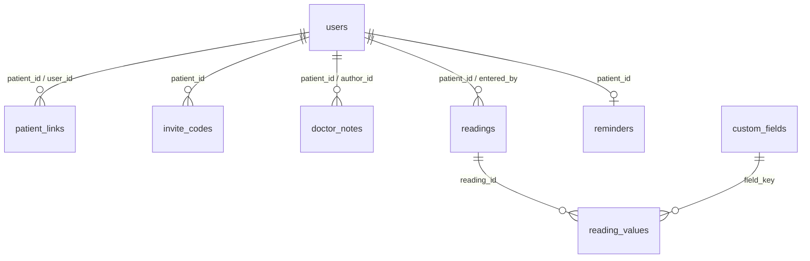

# Database Schema (SQLite + Drizzle)

One SQLite database file (`api/data/ehealth.db`) stores all tables for the modular monolith.
Each module owns its own `schema.ts`; cross-module foreign keys import tables **only** through the owning module's `index.ts`.

## Entity Relationship Overview



## Tables by Module

### 1. `accounts` (`api/src/modules/accounts/schema.ts`)

| Table | Purpose | Key Columns |
|---|---|---|
| `users` | All 5 roles (`patient`, `caretaker`, `family`, `doctor`, `admin`) | `id` (PK), `role`, `name_en`, `name_km`, `phone` (unique), `email` (unique), `password_hash`, `age`, `conditions_en`, `conditions_km`, `created_at` |
| `patient_links` | Controls who can view a patient (`canView`) | `id` (PK), `patient_id` (FK → `users.id`), `user_id` (FK → `users.id`), `relation`, `status` (`active`/`pending`/`revoked`), `initiated_by_patient`, `created_at`. Unique `(patient_id, user_id)` |
| `invite_codes` | 6-digit 24-hour invite codes (US-03) | `code` (PK), `patient_id` (FK → `users.id`), `relation`, `expires_at`, `used_at`, `created_at` |
| `doctor_notes` | Clinical notes on a patient's report (US-19) | `id` (PK), `patient_id` (FK → `users.id`), `author_id` (FK → `users.id`), `text`, `created_at` |

**Startup hook (`accounts/index.ts`):** Registers the real SQLite `canView` rule via `registerAccessChecker(...)` (admin sees all, patient sees self, others require an `active` row in `patient_links`).

### 2. `readings` (`api/src/modules/readings/schema.ts`)

| Table | Purpose | Key Columns |
|---|---|---|
| `custom_fields` | Built-in measures (`systolic`, `diastolic`, `pulse`, `glucose`) + admin-added fields (`weight`, etc.) (US-16) | `id` (PK), `name_en`, `name_km`, `unit`, `decimals`, `min_value`, `max_value`, `normal_min`, `normal_max`, `built_in`, `active`, `created_at` |
| `readings` | One measurement event (morning reading) | `id` (PK), `patient_id` (FK → `users.id`), `entered_by` (FK → `users.id`), `measured_at`, `method` (`manual`/`ocr`), `note`, `photo_uri`, `created_at`, `updated_at` |
| `reading_values` | Flexible key/value numbers per reading so admin custom fields require **zero** schema changes | `(reading_id, field_key)` composite PK, `reading_id` (FK → `readings.id`), `field_key` (FK → `custom_fields.id`), `value` (real) |
| `reminders` | Per-patient morning reminder time (US-17) | `patient_id` (PK, FK → `users.id`), `enabled`, `minutes_after_midnight` (default `390` = 6:30 AM), `updated_at` |

**Public query (`readings/index.ts`):** `listReadings(db, patientId)` reads `readings` + `reading_values` and returns `{ id, measuredAt, values }` for the `reports` module.

### 3. `ocr` & `reports`

- **`ocr`**: No tables (processes device photos and returns pre-filled values).
- **`reports`**: No tables (computes `/summary` and `/series` on the fly from `readings.listReadings()`).

## Useful Commands

```zsh
# Recreate api/data/ehealth.db from scratch (migrations + startups + seeds)
pnpm --filter @ehealth/api db:reset

# Re-run seeds without deleting existing data (idempotent)
pnpm --filter @ehealth/api db:seed

# Generate a new SQL migration after changing any schema.ts
pnpm --filter @ehealth/api db:generate

# Browse and edit tables in your browser via Drizzle Studio
pnpm --filter @ehealth/api db:studio
```
